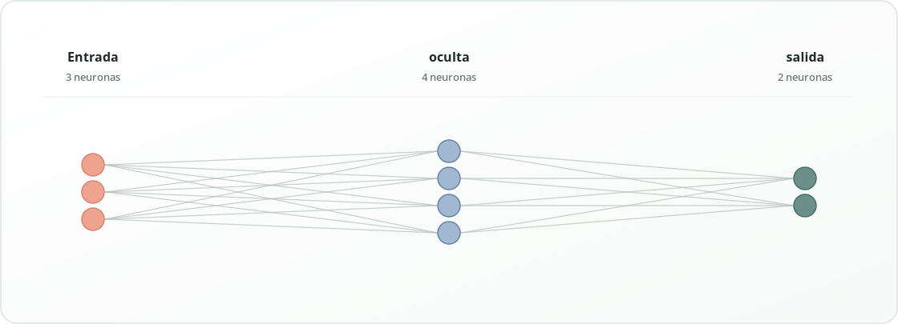

# NeuroCheck

**Compilador educativo de un lenguaje para definir redes neuronales.**  
Versión `1.1.0` · Python · Lark · Streamlit · pytest

**Proyecto académico de Compiladores (2026-2).** Herramienta para interpretar un lenguaje sencillo llamado *NeuroLang* y encontrar errores en las dimensiones declaradas de los pesos de redes neuronales densas.

## Qué hace y qué no hace

- **Hace:** reconocer tokens, verificar la gramática, construir un árbol sintáctico y un AST, registrar capas en una tabla de símbolos y comprobar dimensiones y nombres duplicados.
- **No hace:** entrenar redes neuronales, verificar gradientes, hacer backpropagation, ejecutar PyTorch/TensorFlow, evaluar pesos numéricos ni usar modelos de lenguaje.
- La IA es el **dominio de aplicación** (configuración de una red), no el mecanismo que detecta errores.

## Requisitos

- Python 3.10 o superior.
- Streamlit solo para la interfaz web local; la lógica del compilador puede ejecutarse por terminal.
- Dependencias: `lark`, `streamlit`, `pytest`.

## Instalación y ejecución (Windows / VS Code)

**Importante si ya tenías la versión anterior:** renombra o elimina la carpeta antigua antes de descomprimir este ZIP. No combines archivos de ambas versiones, porque la anterior tenía módulos de entrenamiento que aquí se retiraron.

Descomprime el ZIP, abre la carpeta `NeuroCheck` en VS Code y, dentro de su terminal PowerShell, ejecuta:

```powershell
py -3 -m venv .venv
.\.venv\Scripts\python.exe -m pip install -r requirements.txt
.\.venv\Scripts\python.exe -m streamlit run app.py
```

También puedes hacer doble clic en `INICIAR_WINDOWS.bat`. La aplicación abrirá una dirección local como `http://localhost:8501`.

## Ejecutar solo el compilador por consola

```powershell
.\.venv\Scripts\python.exe -m neurocheck.cli examples/red_correcta.neuro
.\.venv\Scripts\python.exe -m neurocheck.cli examples/error_dimensiones.neuro
.\.venv\Scripts\python.exe -m neurocheck.cli examples/error_sintaxis.neuro --tokens
.\.venv\Scripts\python.exe -m neurocheck.cli examples/red_correcta.neuro --arbol
.\.venv\Scripts\python.exe -m neurocheck.cli examples/red_correcta.neuro --json
```

Los ejemplos con errores devuelven código de salida 1: es el resultado esperado de la validación.

## Ejecutar pruebas

```powershell
.\.venv\Scripts\python.exe -m pytest -v
```

## Sintaxis de NeuroLang

```text
red MiRed {
    entrada 3;
    capa oculta: densa(4, pesos=[3,4]);
    capa salida: densa(2, pesos=[4,2]);
}
```

Convención: `pesos=[entradas de la capa, neuronas de la capa]`.

Al cambiar la última declaración a `pesos=[5,2]`, NeuroCheck señala el error semántico E201 y recomienda `pesos=[4,2]`.

## Estructura del repositorio

```text
NeuroCheck/
├── app.py                 # Interfaz Streamlit (presentación)
├── CHANGELOG.md           # Historial real de cambios de las versiones
├── .github/workflows/     # CI de pruebas automatizadas
├── neurocheck/
│   ├── grammar.lark       # Gramática del lenguaje
│   ├── compiler.py        # Lexer, parser, AST y reglas semánticas
│   ├── cli.py             # Ejecutable por terminal
│   └── visualization.py   # Diagrama SVG independiente del motor
├── examples/              # 6 ejemplos correctos y con errores
├── tests/                 # Pruebas del compilador y visualización
├── assets/                # Vista previa real del diagrama
├── docs/                  # Planteamiento, reporte, sustentación, video y registro
├── requirements.txt
├── INICIAR_WINDOWS.bat
└── VERIFICAR_WINDOWS.bat
```

## Por qué Streamlit

El PDF del proyecto **no exige una interfaz o tecnología específica**: pide código, informe y una demostración funcional. Streamlit permite visualizar resultados sin añadir HTML, CSS, JavaScript o un servidor web propio. Si Streamlit no funciona, `neurocheck.cli` permite mostrar las mismas comprobaciones del motor por consola.

## Limitaciones

La interfaz presenta una estética clara y minimalista, con un diagrama SVG que conserva su relación de aspecto. El componente muestra hasta 6 neuronas por capa y resume las capas intermedias de redes grandes.

El proyecto valida **formas de matrices**, no valores de pesos. El diseño se restringe a redes densas y a programas escritos en el DSL NeuroLang. La visualización dibuja hasta seis neuronas por capa, aunque los cálculos de dimensiones usan los tamaños reales.

## Entregables académicos

En `docs/` se incluyen el planteamiento, reporte técnico, guía de sustentación, guion de video (máx. 5 min), pruebas, contribuciones y ficha para registrar el proyecto.

## Evolución del proyecto

Esta versión conserva el motor de compilación de `1.0.0`. La actualización `1.1.0` corrige la escala y los cortes del SVG, moderniza la interfaz y retira el texto inferior. Los cambios se describen en [CHANGELOG.md](CHANGELOG.md). No se han simulado commits ni fechas de contribución.

**Vista previa del diagrama generado:**



## Publicación en GitHub

Si ya existe un repositorio, sustituye en él **solo los archivos modificados** o copia el contenido de esta versión sobre la carpeta del proyecto, conservando `.git`. Revisa `git status` y `git diff` antes de confirmar. No copies el archivo ZIP al repositorio como única evidencia: publica los archivos fuente.

```bash
git status
git diff
python -m pytest -q
git add app.py neurocheck/visualization.py neurocheck/__init__.py tests/test_visualization.py .streamlit/config.toml pyproject.toml README.md CHANGELOG.md .github assets docs
git commit -m "fix(ui): ajustar diagrama neuronal y renovar interfaz"
git push origin main
```

Ajusta la rama en el último comando si tu repositorio usa otro nombre. Git usa la identidad configurada por quien realiza el commit; no hay que falsificar autorías o historiales. Se deben completar los nombres de integrantes y respaldar las contribuciones reales con el historial de Git.
