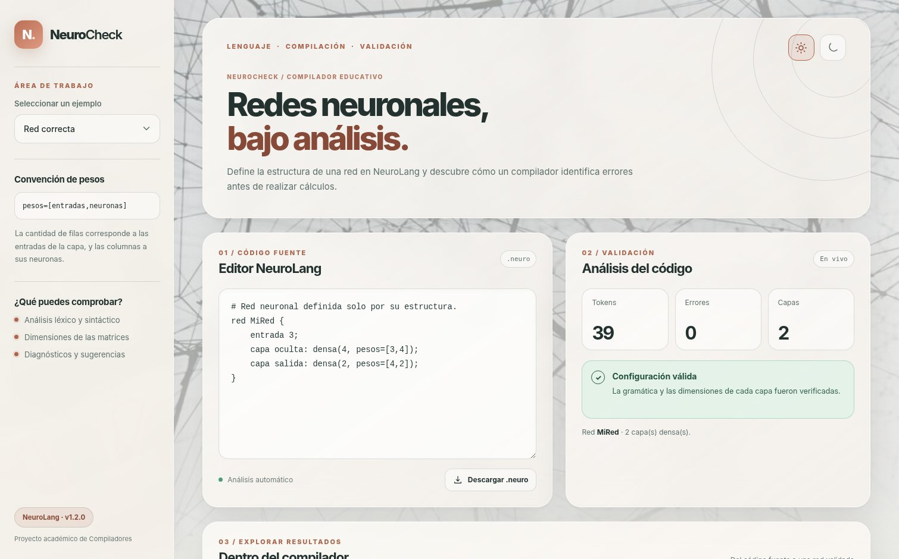
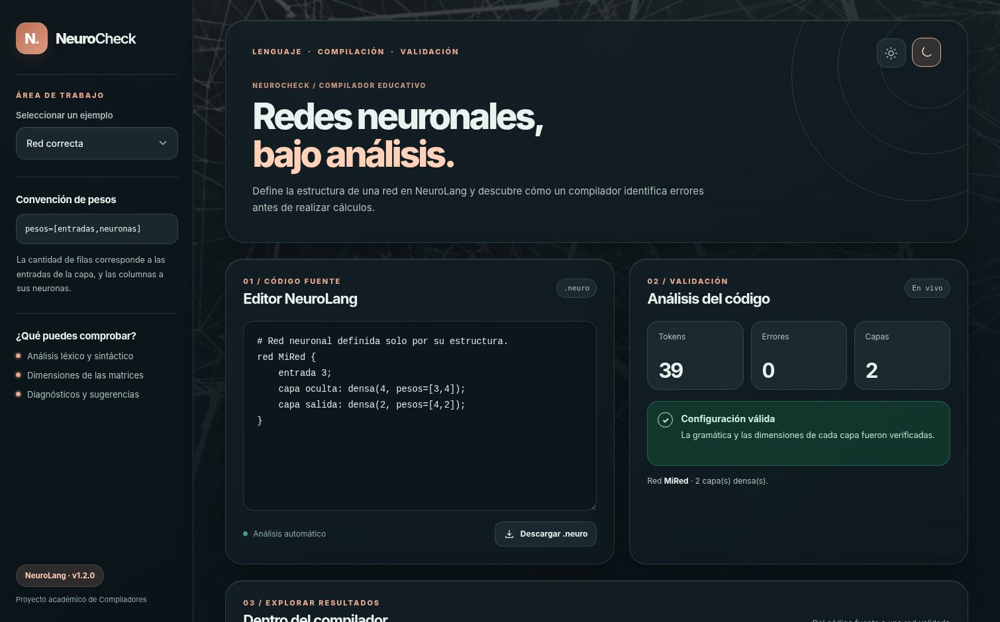

# NeuroCheck

**Compilador educativo de un lenguaje para describir redes neuronales densas.**  
**Versión:** 1.2.0 · **Tecnologías:** Python, Lark, HTML, CSS y JavaScript.

NeuroCheck es un proyecto académico de Compiladores (2026-2). Analiza programas escritos en **NeuroLang**, identifica errores léxicos y sintácticos, construye un árbol de análisis y un AST, y verifica que las matrices de pesos tengan dimensiones compatibles con las capas declaradas.

No ejecuta redes neuronales, no entrena modelos, no calcula gradientes y no utiliza un servicio de IA externo. El tema de inteligencia artificial es el **campo de aplicación del lenguaje**, no el mecanismo de detección de errores.

## Vista previa

| Claro | Oscuro |
|---|---|
|  |  |

La barra lateral ocupa toda la altura disponible en escritorio. El fondo utiliza la fotografía incluida en `assets/` y su versión invertida en el tema oscuro. Los controles de sol y luna permiten cambiar entre temas; la selección se conserva en el navegador.

## Instalación en Windows / VS Code

Necesitas **Python 3.10 o superior**. Abre esta carpeta (la que contiene `app.py`) en VS Code y ejecuta:

```powershell
py -3 -m venv .venv
.\.venv\Scripts\python.exe -m pip install -r requirements.txt
.\.venv\Scripts\python.exe app.py
```

Visita **http://127.0.0.1:8501**. Para detener el programa, presiona `Ctrl + C` en la terminal.

También puedes hacer doble clic en `INICIAR_WINDOWS.bat` para instalar las dependencias y ejecutar el proyecto. Si el puerto 8501 está ocupado por una instancia antigua de Streamlit, detén ese proceso o ejecuta:

```powershell
.\.venv\Scripts\python.exe app.py --port 8502
```

**Importante:** desde v1.2.0 la interfaz **ya no utiliza Streamlit**. El servidor es Python estándar (`http.server`) y el frontend se implementó con HTML, CSS y JavaScript. Esta decisión evita los estilos internos de Streamlit que causaban problemas de contraste, espaciado y barra lateral en versiones anteriores.

## Ejemplo del lenguaje

```text
red MiRed {
    entrada 3;
    capa oculta: densa(4, pesos=[3,4]);
    capa salida: densa(2, pesos=[4,2]);
}
```

Se usa la convención **`pesos=[entradas,neuronas]`**. La capa de salida recibe cuatro valores de la capa anterior y tiene dos neuronas, por lo que necesita una matriz de `4 × 2`. Si se declara `pesos=[5,2]`, el analizador genera un diagnóstico **E201** con la sugerencia `pesos=[4,2]`.

## ¿Qué muestra la aplicación?

- **Editor:** se puede escribir y descargar un archivo `.neuro`; los diagnósticos se actualizan automáticamente.
- **Resumen:** número de tokens, errores y capas detectadas.
- **Fases del compilador:** tokens, árbol sintáctico, AST y tabla de símbolos.
- **Arquitectura neuronal:** diagrama de neuronas y conexiones generado desde el modelo validado. Tiene variantes de color para tema claro y oscuro.
- **Ejemplos:** seis programas listos para demostrar casos válidos y errores.

## Ejecutar el compilador por consola

```powershell
.\.venv\Scripts\python.exe -m neurocheck.cli examples/red_correcta.neuro
.\.venv\Scripts\python.exe -m neurocheck.cli examples/error_dimensiones.neuro
.\.venv\Scripts\python.exe -m neurocheck.cli examples/error_sintaxis.neuro --tokens
.\.venv\Scripts\python.exe -m neurocheck.cli examples/red_correcta.neuro --arbol
.\.venv\Scripts\python.exe -m neurocheck.cli examples/red_correcta.neuro --json
```

Los programas de ejemplo con errores terminan con código de salida 1 como parte del comportamiento esperado.

## Pruebas

```powershell
.\.venv\Scripts\python.exe -m pytest -q
```

En esta revisión **30 pruebas automatizadas** pasaron: 18 del compilador, 6 del visualizador y 6 del servidor/interfaz. También se revisó la presentación visual en Chromium con la página cargada localmente y respuestas de ejemplo equivalentes a las de la API; el servidor y los endpoints se probaron por separado. La ejecución en tu computadora sigue siendo la comprobación final antes de publicar la versión.

## Estructura

```text
NeuroCheck/
├── app.py                    # Servidor HTTP local y API /api/compile
├── web/
│   ├── index.html            # Estructura semántica de la interfaz
│   ├── styles.css            # Temas y diseño (liquid glass)
│   └── app.js                # Interactividad y visualización de resultados
├── neurocheck/
│   ├── grammar.lark          # Gramática de NeuroLang
│   ├── compiler.py           # Lexer, parser, AST, semántica y diagnósticos
│   ├── visualization.py      # Diagrama SVG claro y oscuro
│   └── cli.py                # Ejecución por consola
├── assets/                   # Imágenes, favicon y capturas
├── examples/                 # Seis entradas de ejemplo
├── tests/                    # Pruebas unitarias y HTTP
├── docs/                     # Planteamiento, informe, guion y sustentación
├── CHANGELOG.md
├── requirements.txt
├── INICIAR_WINDOWS.bat
└── VERIFICAR_WINDOWS.bat
```

## Arquitectura de ejecución

`web/app.js` envía el texto a `POST /api/compile`. `app.py` llama a `compile_source()` y devuelve JSON con los tokens, los diagnósticos, el AST y la tabla de símbolos. Si la red es válida, se genera un diagrama SVG con `network_svg()`. La interfaz **no decide si un programa es válido**: esa responsabilidad sigue en `neurocheck/compiler.py`.

La aplicación sólo escucha en `127.0.0.1` por defecto; es una herramienta local, no un servicio desplegado públicamente.

## Limitaciones y alcance

- NeuroLang define redes con capas densas y cantidades de neuronas, no el conjunto de operaciones de un framework de ML.
- No verifica valores numéricos de pesos, solamente las dimensiones declaradas.
- El diagrama representa hasta seis neuronas por capa y resume redes grandes para favorecer la lectura.
- No valida modelos PyTorch o TensorFlow, ni ejecuta inferencia o entrenamiento.

## Publicar una actualización en GitHub

Si ya has subido v1.1.0, reemplaza los archivos del proyecto **conservando la carpeta oculta `.git`** y revisa qué cambió antes de confirmar:

```powershell
git status
git diff --stat
.\.venv\Scripts\python.exe -m pytest -q
git add -A
git commit -m "feat(ui): rediseñar interfaz y unificar temas claro y oscuro"
git push origin main
```

Si decides marcar la versión:

```powershell
git tag v1.2.0
git push origin v1.2.0
```

Usa un mensaje que refleje los cambios reales y etiqueta la versión únicamente cuando la hayas revisado en tu computador.

## Créditos y referencias

- Motor léxico y sintáctico: [Lark](https://lark-parser.readthedocs.io/).
- Diagrama: SVG generado localmente por código Python propio.
- Imagen de fondo: **Alina Grubnyak**, fotografía compartida por el usuario, archivo de origen `alina-grubnyak-ZiQkhI7417A-unsplash.jpg` (Unsplash). Verifica las condiciones de uso aplicables al publicarla.
- Documentación académica y otros recursos: consulta `docs/`.
